# Sistema de Alerta Temprana para Plagas y Enfermedades en Cultivos Bolivianos 🌱🇧🇴

[](https://cbarriosperez.github.io/Project_Pests_Diseases_Bolivian_Crops/)
[](https://github.com/cbarriosperez/Project_Pests_Diseases_Bolivian_Crops/actions/workflows/pronostico_diario.yml)


**[➡️ Abrir la plataforma](https://cbarriosperez.github.io/Project_Pests_Diseases_Bolivian_Crops/)**

Plataforma abierta que combina **series climáticas históricas**, **pronósticos meteorológicos diarios** y **15 modelos agroclimáticos** para anticipar el riesgo de plagas y enfermedades en **15 cultivos priorizados de Bolivia**, a nivel municipal. Todo el flujo, desde la descarga del pronóstico hasta la publicación de los mapas de alerta, se ejecuta **automáticamente cada día** en GitHub Actions.

Este documento describe en detalle la plataforma: datos, modelos, scripts, arquitectura, automatización e interfaz web.

---

## 📑 Contenido

1. [Descripción del proyecto](#1-descripción-del-proyecto)
2. [La plataforma en un vistazo](#2-la-plataforma-en-un-vistazo)
3. [Arquitectura](#3-arquitectura)
4. [Estructura del repositorio](#4-estructura-del-repositorio)
5. [Datos](#5-datos)
6. [Modelos agroclimáticos](#6-modelos-agroclimáticos)
7. [Scripts](#7-scripts)
8. [Integración de los scripts](#8-integración-de-los-scripts)
9. [Automatización diaria (GitHub Actions)](#9-automatización-diaria-github-actions)
10. [Plataforma web](#10-plataforma-web)
11. [Guía de uso y mantenimiento](#11-guía-de-uso-y-mantenimiento)
12. [Limitaciones y consideraciones](#12-limitaciones-y-consideraciones)
13. [Solución de problemas](#13-solución-de-problemas)
14. [Reportes y productos](#14-reportes-y-productos)
15. [Hoja de ruta](#15-hoja-de-ruta)
16. [Fuentes, licencias y créditos](#16-fuentes-licencias-y-créditos)

---

## 1. Descripción del proyecto

### 1.1 Contexto y objetivo

El proyecto desarrolla e implementa un **Sistema de Alerta Temprana (SAT)** para el monitoreo de plagas y enfermedades en cultivos clave de Bolivia. El sistema traduce condiciones climáticas observadas y pronosticadas en **niveles de riesgo** (semáforo) que permiten a productores, técnicos e instituciones **tomar medidas preventivas antes de que aparezca el brote**.

| | |
|---|---|
| **Ejecución** | Alliance of Bioversity International & CIAT (CGIAR), en conjunto con YAPU Solutions |
| **Cliente** | BDP (Bolivia) |
| **Periodo** | Febrero – octubre de 2026 |
| **Cobertura** | 15 cultivos, 15 indicadores de plaga/enfermedad, 305 municipios productores |
| **Resolución** | 5 km (análisis histórico) · municipio (pronóstico y alertas diarias) |
| **Responsable técnico** | [Camilo Barrios-Pérez](https://github.com/cbarriosperez), Agroclimatic Modeling Team |

### 1.2 Fases del proyecto

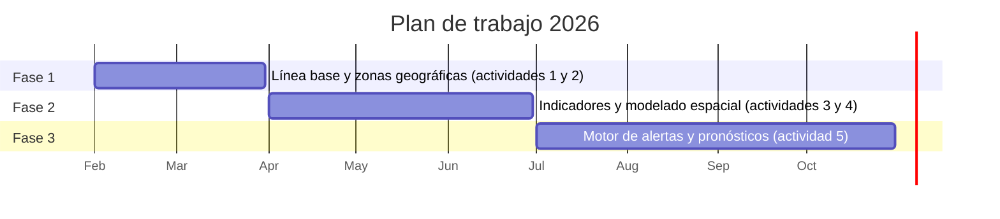

| Fase | Meses | Actividades | Productos |
|---|---|---|---|
| 1. Línea base y zonas geográficas | Feb – Mar | **1.** Definición de cultivos y áreas de estudio (INE, MDRyT, FAOSTAT, zonificación municipal con SIG). **2.** Identificación de plagas y enfermedades (revisión bibliográfica, encuestas a agrónomos y extensionistas) | Informe de inicio · Catálogo de plagas y enfermedades con umbrales críticos · Reporte 1 |
| 2. Indicadores y modelado espacial | Abr – Jun | **3.** Indicadores agroclimáticos (series CHIRPS y AgERA5, umbrales por variable). **4.** Análisis espacio-temporal de vulnerabilidad a 5 km | Paquete de índices de riesgo · Mapas de vulnerabilidad · Reportes 2 y 3 |
| 3. Motor de alertas y pronósticos | Jul – Oct | **5.** Pronóstico y evaluación del riesgo, emisión de alertas | Motor SAT automatizado e integrable · Plataforma web |

### 1.3 Cultivos y amenazas priorizadas

| Cultivo | Plaga / enfermedad | Tipo | Importancia del cultivo |
|---|---|---|---|
| 🧄 Ajo | Fusariosis (pudrición basal) | Enfermedad (hongo) | Hortícola de alto valor, valles de Tarija y Chuquisaca |
| 🍌 Banano | Sigatoka negra | Enfermedad (hongo) | Trópico de Cochabamba y Yungas; exportación |
| ☕ Café | Broca del café | Plaga (insecto) | Cafés especiales de los Yungas; exportación |
| 🧅 Cebolla | Mildiu (polvillo negro) | Enfermedad (oomiceto) | Hortaliza básica de valles |
| 🍑 Durazno | Arañuela roja | Plaga (ácaro) | Valles interandinos (Cochabamba, Chuquisaca) |
| 🍑 Durazno | Oídio | Enfermedad (hongo) | Valles interandinos |
| 🍓 Frutilla | Botrytis (moho gris) | Enfermedad (hongo) | Alto valor para la agricultura familiar |
| 🥬 Lechuga | *Sclerotinia sclerotiorum* | Enfermedad (hongo) | Cinturones periurbanos y valles |
| 🌽 Maíz choclo | Gusano cogollero | Plaga (insecto) | Gastronomía tradicional, valles |
| 🌽 Maíz de grano | Roya | Enfermedad (hongo) | Llanos y Chaco; industria y alimento animal |
| 🍊 Naranja | Mosca de la fruta | Plaga (insecto) | Zonas subtropicales; plaga cuarentenaria |
| 🥔 Papa | Gorgojo de los Andes | Plaga (insecto) | Seguridad alimentaria; mayor superficie del país |
| 🌾 Quinua | Ticona | Plaga (polilla) | Altiplano sur; exportación de quinua real |
| 🍅 Tomate | Polilla (*Tuta absoluta*) | Plaga (insecto) | Campo abierto y carpas solares |
| 🍇 Uva | Mildiu de la uva | Enfermedad (oomiceto) | Tarija y Cinti; vino de altura y singani |

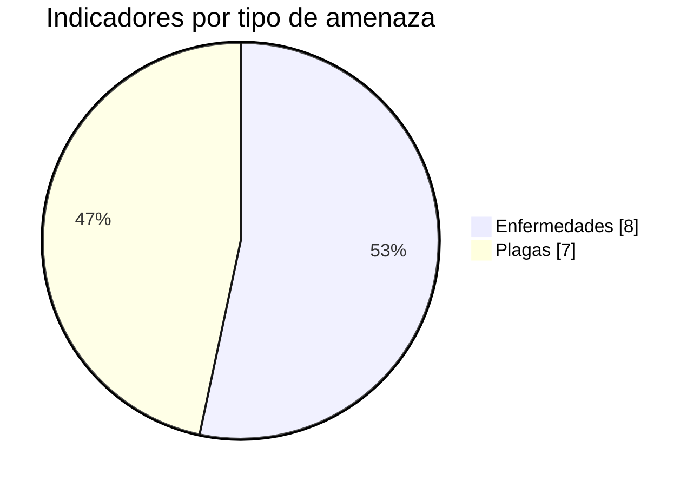

> El censo incluye además **Maíz berza** (11 municipios), presente en la geometría pero **sin modelo agroclimático** por ahora.

---

## 2. La plataforma en un vistazo

La plataforma web tiene cinco secciones: **Presentación**, **Explorar Datos**, **Metodología**, **Reportes** y **Scripts**. El corazón es el **Explorador de Datos**, con tres herramientas:

| Herramienta | Qué muestra | Fuente | Actualización |
|---|---|---|---|
| 🌦️ **Pronóstico del clima** | Precipitación, Tmax, Tmin y humedad relativa para 16 días, por municipio productor y modelo | `data/pronostico/pronostico_latest.json` | Diaria (06:00 Bolivia) |
| 🐛 **Alertas de plagas y enfermedades** | Semáforo de riesgo por cultivo, plaga y municipio, con el detalle de cada condición | `data/alertas/alertas_latest.json` | Diaria, justo después del pronóstico |
| 🗺️ **Riesgo histórico** | Mapas del índice de riesgo calculado con clima observado (2023–2025) | `Salidas_Modelos_Agroclimaticos/` + `explorer_data.js` | Estática |

<table>
<tr>
<td width="50%">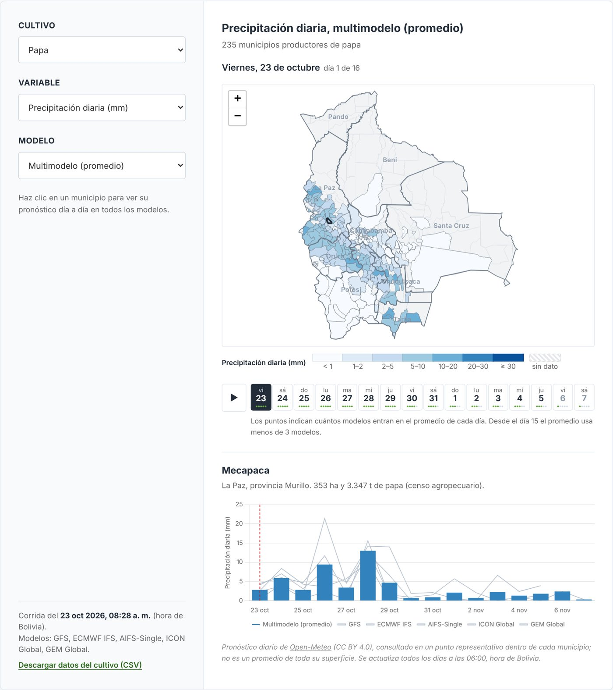<br><sub><b>Pronóstico del clima:</b> mapa por día, tira de 16 días con número de modelos que aportan y serie del municipio en todos los modelos.</sub></td>
<td width="50%">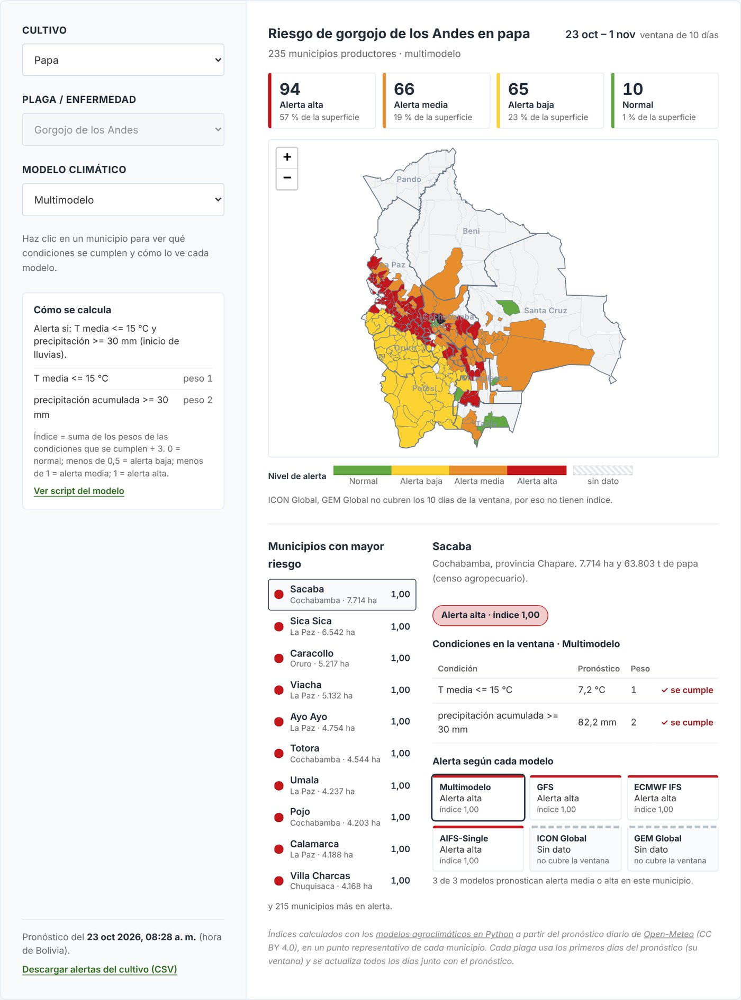<br><sub><b>Alertas:</b> resumen por nivel, mapa semáforo, municipios con mayor riesgo y detalle de condiciones por modelo.</sub></td>
</tr>
</table>

---

## 3. Arquitectura

La plataforma es un **sitio estático** (HTML, CSS y JavaScript) publicado en GitHub Pages. No hay servidor ni base de datos: los datos dinámicos son archivos JSON que **GitHub Actions regenera y versiona cada día** en el propio repositorio.

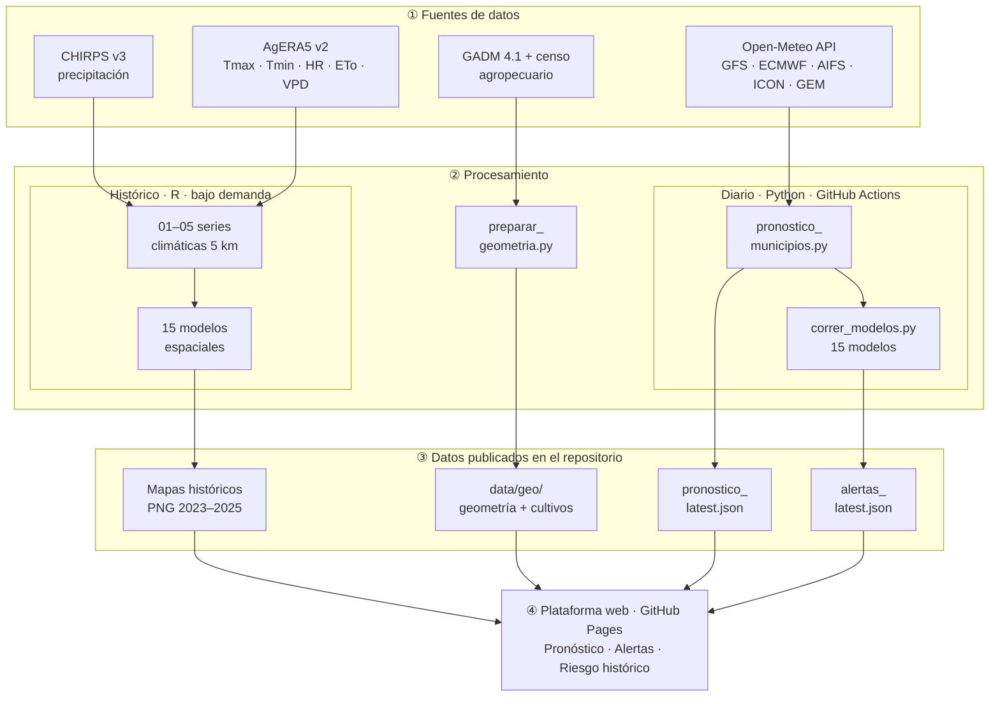

### 3.1 Componentes y tecnologías

| Capa | Tecnología | Uso |
|---|---|---|
| Procesamiento histórico | R (`terra`, `sf`, `sp`, `dplyr`, `lubridate`, `ggplot2`, `tidyterra`) | Series climáticas a 5 km y modelos espaciales |
| Preparación geográfica | Python (`geopandas` ≥ 1.0, `shapely` ≥ 2.1) | Simplificación de geometría e índice cultivo → municipios |
| Pronóstico y alertas | Python 3.12 (`numpy`, `pandas`, `requests`) | Descarga Open-Meteo y cálculo de los 15 índices |
| Automatización | GitHub Actions (cron diario) | Ejecuta el pronóstico y los modelos, hace commit de los JSON |
| Publicación | GitHub Pages | Sirve el sitio estático desde la rama `main` |
| Interfaz | HTML/CSS/JS sin framework, [Leaflet 1.9.4](https://leafletjs.com/), [Chart.js 4.4.1](https://www.chartjs.org/), fuente Inter | Mapas, gráficos y controles interactivos |
| Exploración | Google Colab (Python: `xarray`, `rasterio`, `geopandas`, `matplotlib`) | Notebook de visualización de variables históricas |

### 3.2 Decisiones de diseño

- **Sin servidor:** todo se precalcula; el navegador solo lee JSON. Costo de operación cero y nada que mantener en línea.
- **Datos versionados en Git:** cada corrida diaria es un commit, así que el **historial de commits funciona como archivo de pronósticos y alertas pasados**.
- **Un script por modelo:** cada indicador vive en su propio archivo, autocontenido y descargable desde la web, igual que sus pares en R.
- **Fallos aislados:** si un modelo climático o un indicador falla, los demás siguen; si todo falla, se conserva la versión anterior.

---

## 4. Estructura del repositorio

```text
Project_Pests_Diseases_Bolivian_Crops/
├── index.html                          # Sitio web (todas las secciones)
├── pronostico_explorer.js / .css       # Explorador: pronóstico 16 días + selector de herramientas
├── alertas_explorer.js / .css          # Explorador: alertas de plagas y enfermedades
├── explorer_data.js                    # Índice de mapas históricos (cultivo → plaga → año → periodo → PNG)
├── .github/workflows/
│   └── pronostico_diario.yml           # Automatización diaria (pronóstico + alertas)
├── Scripts/
│   ├── Bases de datos climáticas historicas/
│   │   ├── 01_Precipitacion_CHIRPS.R
│   │   ├── 02_Tmax_AgERA5.R
│   │   ├── 03_Tmin_AgERA5.R
│   │   ├── 04_HumedadRelativa_AgERA5.R
│   │   └── 05_PET_VPD_AgERA5.R
│   ├── Modelos_Agroclimaticos_R/       # 15 modelos espaciales (píxel, histórico)
│   │   ├── <Cultivo>/Script_Indice_Riesgo_<Cultivo>_Espacial.R
│   │   └── Durazno/{Aranuela_roja,Oidio}/...
│   ├── Modelos_Agroclimaticos_Python/  # 15 modelos sobre el pronóstico (municipio, diario)
│   │   ├── <Cultivo>/Script_Indice_Riesgo_<Cultivo>_Pronostico.py
│   │   ├── Durazno/{Aranuela_roja,Oidio}/...
│   │   ├── correr_modelos.py           # Ejecuta los 15 y escribe alertas_latest.json
│   │   └── README.md
│   └── pronostico/
│       ├── preparar_geometria.py       # Shapefiles → GeoJSON + índice de cultivos
│       ├── pronostico_municipios.py    # Descarga Open-Meteo → pronostico_latest.json
│       └── requirements.txt
├── data/
│   ├── geo/
│   │   ├── municipios_bolivia.geojson      # 344 municipios simplificados + punto de consulta
│   │   ├── departamentos_bolivia.geojson   # 9 departamentos
│   │   ├── cultivos_municipios.json        # cultivo → municipios productores (ha, t)
│   │   └── shapefiles/                     # GADM 4.1 nivel 3 y shapefiles por cultivo
│   ├── pronostico/pronostico_latest.json   # Generado a diario
│   └── alertas/alertas_latest.json         # Generado a diario
├── Salidas_Modelos_Agroclimaticos/     # Mapas históricos (salidas_<cultivo>_<año>/*.png)
├── Reportes/                           # Reportes técnicos en PDF
├── Infografias/  figures/  Videos/     # Material gráfico de la web
├── docs/img/                           # Figuras de esta documentación
└── Work Plan Componente B5.xlsx        # Plan de trabajo
```

> `.gitignore` excluye los `*.tif`: las series diarias a 5 km viven en los servidores de la Alianza, no en el repositorio.

---

## 5. Datos

### 5.1 Series climáticas históricas (1981–2025)

Armonizadas a una **grilla común de 5 km** (la de CHIRPS v3) sobre la extensión de Bolivia: misma extensión, sistema de coordenadas y resolución para todas las variables.

| Variable | Fuente | Procesamiento | Unidad | Archivo diario |
|---|---|---|---|---|
| Precipitación | CHIRPS v3 (CHIRPS_V3_ERA5_Daily) | Recorte y máscara a Bolivia; valores negativos → NA | mm/día | `chirps-v3.0.AAAA.MM.DD.tif` |
| Temperatura máxima | AgERA5 v2 (`Temperature-Air-2m_Max-24h`) | Recorte, K → °C (−273,15), remuestreo bilineal a 5 km | °C | `Tmax_AAAA-MM-DD.tif` |
| Temperatura mínima | AgERA5 v2 (`Temperature-Air-2m_Min-24h`) | Igual que Tmax | °C | `Tmin_AAAA-MM-DD.tif` |
| Humedad relativa | AgERA5 v2 (`Relative-Humidity-2m_12h`) | Recorte, remuestreo bilineal a 5 km | % | `RHum_AAAA-MM-DD.tif` |
| Evapotranspiración de referencia | AgERA5 v2 (`ReferenceET-PenmanMonteith-FAO56`) | Recorte, remuestreo bilineal a 5 km | mm/día | `ETo_AAAA-MM-DD.tif` |
| Déficit de presión de vapor | AgERA5 v2 (`Vapour-Pressure-Deficit`) | Recorte, remuestreo bilineal a 5 km | kPa | `VPD_AAAA-MM-DD.tif` |

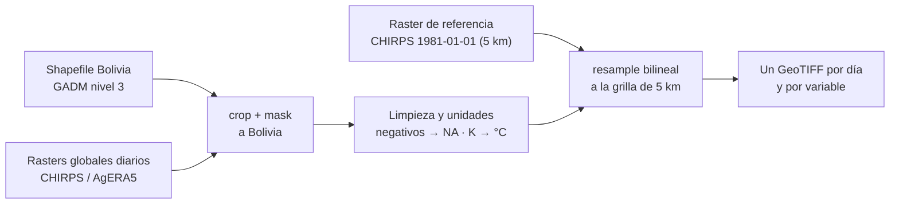

### 5.2 Pronóstico meteorológico (Open-Meteo)

Pronóstico diario a **16 días** desde [Open-Meteo](https://open-meteo.com/) (CC BY 4.0), consultado en el **punto representativo** de cada uno de los **305 municipios productores** (`representative_point()`, siempre dentro del polígono).

| Modelo | Centro | Código Open-Meteo | Tipo | Activo |
|---|---|---|---|---|
| GFS | NOAA (EE. UU.) | `gfs_seamless` | Determinista | Siempre |
| ECMWF IFS | ECMWF (Europa) | `ecmwf_ifs` | Determinista | Siempre |
| AIFS-Single | ECMWF (modelo de IA) | `ecmwf_aifs025_single` | Determinista | Siempre |
| ICON Global | DWD (Alemania) | `icon_global` | Determinista | Siempre |
| GEM Global | ECCC (Canadá) | `gem_global` | Determinista | Siempre |
| GEFS | NOAA | `gfs_seamless` (ensemble) | Ensamble (~31 miembros) | Con API key |
| ECMWF-ENS | ECMWF | `ecmwf_ifs025` (ensemble) | Ensamble (~51) | Con API key |
| AIFS-ENS | ECMWF | `ecmwf_aifs025` (ensemble) | Ensamble (~51) | Con API key |
| GEPS | ECCC | `gem_global` (ensemble) | Ensamble (~21) | Con API key |
| **MULTIMODELO** | — | — | Promedio simple de los modelos disponibles | Siempre |

**Variables:** `precipitation_sum` (mm), `temperature_2m_max` (°C), `temperature_2m_min` (°C), `relative_humidity_2m` (%; media diaria, o media de los valores horarios si el modelo no la ofrece). Para los ensambles se usa la media de todos los miembros.

El horizonte efectivo varía por modelo. En la corrida del 23-oct-2026:

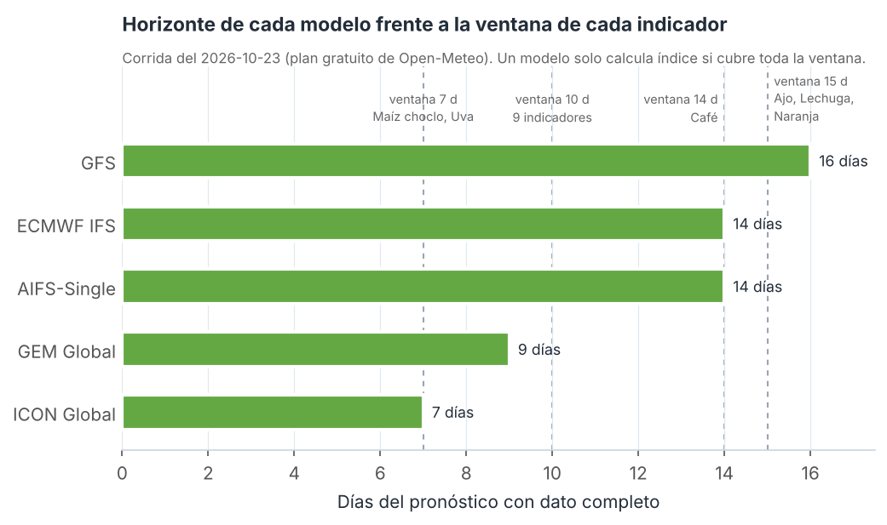

### 5.3 Datos geográficos y de producción

| Archivo | Contenido | Origen |
|---|---|---|
| `gadm41_BOL_3.shp` | 344 municipios de Bolivia (nivel 3) | [GADM 4.1](https://gadm.org/) |
| `Shapefiles_cultivos/<CULTIVO>/<CULTIVO>.shp` | Municipios productores con `MUNICIPIO`, `DEPARTAMEN`, `GID_3`, `SUP_HA`, `PROD_TN` | Censo agropecuario |
| `municipios_bolivia.geojson` | 344 municipios simplificados (~650 m, topología preservada) + `lat`/`lon` del punto de consulta | `preparar_geometria.py` |
| `departamentos_bolivia.geojson` | 9 departamentos (disolución de municipios) | `preparar_geometria.py` |
| `cultivos_municipios.json` | Por cultivo: municipios productores con nombres, superficie (ha) y producción (t) | `preparar_geometria.py` |

| Mapa de municipios productores | Municipios y superficie por cultivo |
|---|---|
| 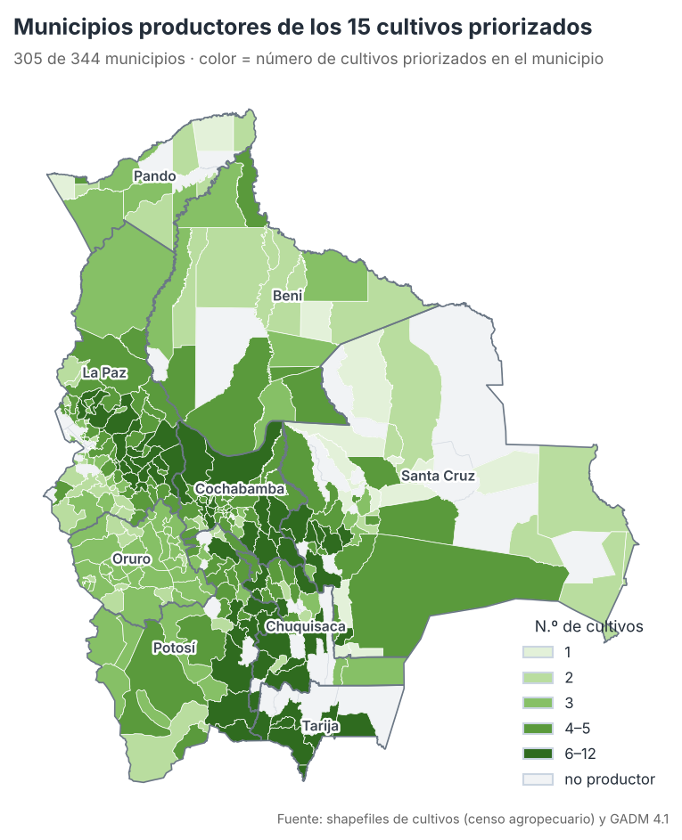 | 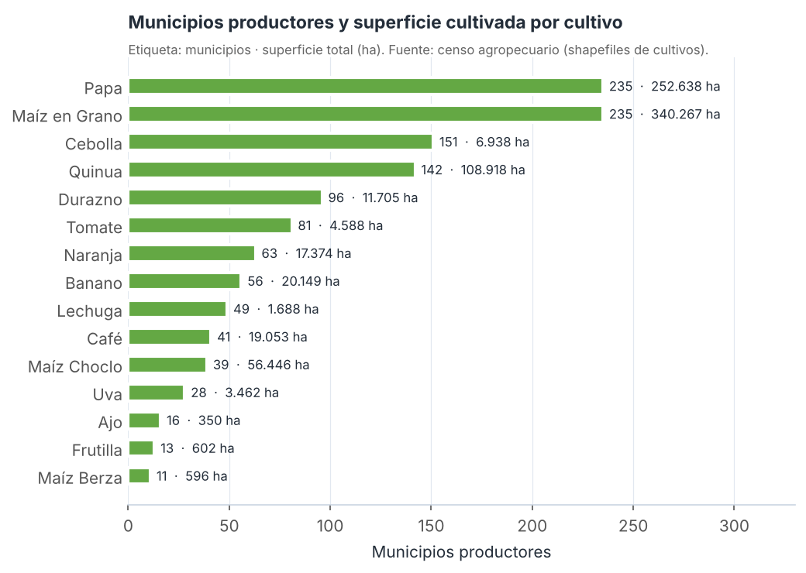 |

### 5.4 Formatos de los archivos dinámicos

<details>
<summary><b><code>data/pronostico/pronostico_latest.json</code></b> (≈ 560 KB)</summary>

```jsonc
{
  "version": 1,
  "generado_utc": "2026-10-23T12:28:24Z",
  "fecha_inicio": "2026-10-23",
  "fechas": ["2026-10-23", "...", "2026-11-07"],           // 16 días, hora local de Bolivia
  "fuente": "Open-Meteo (open-meteo.com), CC BY 4.0",
  "variables": { "precipitation_sum": {"nombre": "Precipitación diaria", "unidad": "mm"}, "...": {} },
  "modelos": ["GFS", "ECMWF IFS", "AIFS-Single", "ICON Global", "GEM Global", "MULTIMODELO"],
  "codigos_modelo": { "GFS": "gfs_seamless", "...": "..." },
  "modelos_fallidos": {},                                  // modelo -> motivo
  "usa_ensambles": false,
  "dias_con_dato": { "GFS": 16, "ECMWF IFS": 14, "ICON Global": 7, "...": 0 },
  "n_modelos_multimodelo": { "precipitation_sum": [5, 5, "...", 1] },   // modelos que aportan cada día
  "municipios": ["BOL.1.1.2_2", "..."],                    // 305 GID_3
  "datos": { "<variable>": { "<modelo>": [[/* 16 valores */], "... una fila por municipio"] } }
}
```
</details>

<details>
<summary><b><code>data/alertas/alertas_latest.json</code></b> (≈ 260 KB)</summary>

```jsonc
{
  "version": 1,
  "generado_utc": "...", "pronostico_generado_utc": "...", "fecha_inicio": "2026-10-23",
  "modelos": ["GFS", "...", "MULTIMODELO"],
  "categorias": [ {"id": 0, "nombre": "Normal", "color": "#64a844"}, "... hasta id 3 (Alerta alta)" ],
  "indicadores": {
    "PAPA": {
      "cultivo": "Papa", "clave_cultivo": "PAPA", "plaga": "Gorgojo de los Andes",
      "periodo_dias_modelo": 10,
      "ventana": {"inicio": "2026-10-23", "fin": "2026-11-01", "dias": 10},
      "umbral": "T media <= 15 °C y precipitación >= 30 mm (inicio de lluvias)",
      "condiciones": { "cond_t": {"descripcion": "T media <= 15 °C", "peso": 1}, "cond_precip": {"...": 2} },
      "script": "Scripts/Modelos_Agroclimaticos_Python/Papa/Script_Indice_Riesgo_Papa_Pronostico.py",
      "municipios": ["BOL.1.1.2_2", "..."],
      "indice":   { "<modelo>": [0.667, 1.0, null, "..."] },      // null = sin dato
      "alerta":   { "<modelo>": [2, 3, -1, "..."] },              // 0..3, -1 = sin dato
      "variables": { "t_media_periodo": { "<modelo>": [12.4, "..."] }, "precip_acum_periodo": {} },
      "condiciones_cumplidas": { "cond_t": { "<modelo>": [1, 0, null, "..."] } }
    },
    "DURAZNO_ARANUELA": {}, "DURAZNO_OIDIO": {}, "...": {}
  },
  "errores": {}                                                 // indicador -> error, si alguno falló
}
```
</details>

<details>
<summary><b><code>data/geo/cultivos_municipios.json</code></b></summary>

```jsonc
{
  "PAPA": {
    "etiqueta": "Papa",
    "municipios": {
      "BOL.2.14.3_2": { "nombres": ["Sipe Sipe"], "sup_ha": 11.5, "prod_tn": 100.6 },
      "...": {}
    }
  }
}
```
Algunos municipios del censo comparten un mismo polígono GADM (p. ej. Jesús de Machaca → Santiago de Machaca); se agregan por `GID_3` y sus nombres se listan juntos.
</details>

---

## 6. Modelos agroclimáticos

### 6.1 Lógica común

Los 15 modelos replican la hoja **"Calculadora_Indice de riesgo"** del Excel del proyecto. Cada indicador evalúa entre dos y tres **condiciones climáticas** sobre un **periodo** (7 a 30 días), las pondera y clasifica el resultado en un **semáforo**.

$$
\text{Índice} \;=\; \frac{\sum_{i} w_i \cdot c_i}{\sum_{i} w_i}, \qquad c_i = \begin{cases} 1 & \text{si se cumple la condición } i \\ 0 & \text{si no} \end{cases}
$$

| Índice | Nivel | Color |
|---|---|---|
| 0 | 🟢 Normal | `#64a844` |
| > 0 y < 0,5 | 🟡 Alerta baja | `#fcd333` |
| ≥ 0,5 y < 1 | 🟠 Alerta media | `#e88d2b` |
| 1 (todas las condiciones) | 🔴 Alerta alta | `#c4161b` |
| sin dato | ⬜ Sin dato | gris |

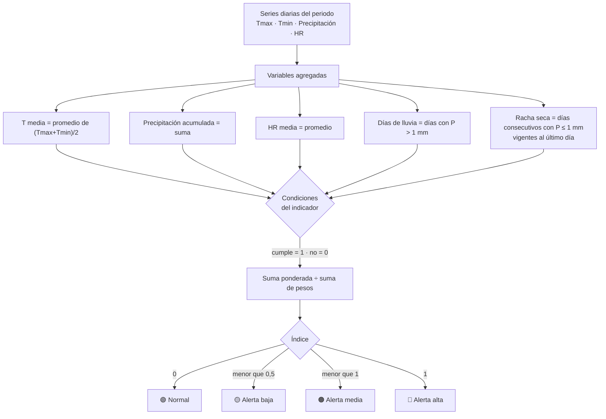

**Variables agregadas** (idénticas en R y en Python):

| Variable | Definición |
|---|---|
| `t_media_periodo` | Promedio de la temperatura media diaria, (Tmax + Tmin) / 2, en el periodo |
| `precip_acum_periodo` | Suma de la precipitación diaria del periodo (mm) |
| `hr_media_periodo` | Promedio de la humedad relativa diaria (%) |
| `dias_lluvia_periodo` | Número de días con precipitación > 1 mm |
| `dias_secos_periodo` | Racha de días consecutivos con precipitación ≤ 1 mm vigente al **último** día del periodo |

Un dato faltante en cualquier día del periodo deja la variable sin valor y el índice queda **sin dato** (equivalente a `mean()`/`sum()` sin `na.rm` en `terra`).

### 6.2 Los 15 indicadores

| Cultivo | Plaga / enfermedad | Periodo | Condiciones (peso) | Σ pesos |
|---|---|---|---|---|
| Ajo | Fusariosis | 15 d | T media ≥ 25 °C (1) · racha seca ≥ 10 d (1) · precipitación < 20 mm (1) | 3 |
| Banano | Sigatoka negra | 10 d | T media 25–28 °C (1) · HR ≥ 90 % (**2**) · precipitación ≥ 50 mm (1) | 4 |
| Café | Broca del café | 30 d\* | T media 20–30 °C (**2**) · precipitación 30–80 mm (1) | 3 |
| Cebolla | Mildiu (polvillo negro) | 10 d | T media 6–22 °C (1) · HR ≥ 90 % (**2**) · días de lluvia ≥ 3 (1) | 4 |
| Durazno | Arañuela roja | 10 d | T media > 25 °C (**2**) · racha seca ≥ 7 d (1) · HR < 50 % (1) | 4 |
| Durazno | Oídio | 10 d | T media 18–25 °C (1) · HR 50–70 % (1) | 2 |
| Frutilla | Botrytis (moho gris) | 10 d | T media 15–23 °C (1) · HR ≥ 90 % (**2**) · días de lluvia ≥ 2 (1) | 4 |
| Lechuga | *S. sclerotiorum* | 15 d | T media 15–20 °C (1) · HR ≥ 85 % (1) · precipitación ≥ 60 mm (**2**) | 4 |
| Maíz choclo | Gusano cogollero | 7 d | T media ≥ 22 °C (**2**) · precipitación ≥ 20 mm (1) | 3 |
| Maíz de grano | Roya | 10 d | T media 15–28 °C (1) · HR ≥ 75 % (**2**) · precipitación ≥ 30 mm (1) | 4 |
| Naranja | Mosca de la fruta | 15 d | T media 20–30 °C (1) · racha seca ≥ 10 d (**2**) | 3 |
| Papa | Gorgojo de los Andes | 10 d | T media ≤ 15 °C (1) · precipitación ≥ 30 mm (**2**) | 3 |
| Quinua | Ticona | 10 d | T media 15–25 °C (1) · precipitación ≥ 30 mm (**2**) · días de lluvia ≥ 3 (1) | 4 |
| Tomate | Polilla (*T. absoluta*) | 10 d | T media > 22 °C (**2**) · racha seca ≥ 7 d (1) · HR < 60 % (1) | 4 |
| Uva | Mildiu de la uva | 7 d | T media ≥ 10 °C (1) · precipitación ≥ 10 mm (1) · HR ≥ 85 % (1) | 3 |

\* En la versión de pronóstico, Café usa una ventana de 14 días y escala el umbral de precipitación (ver 6.4).

**Variables que usa cada indicador:**

| Indicador | T media | Precipitación acumulada | HR media | Días de lluvia | Racha seca |
|---|:-:|:-:|:-:|:-:|:-:|
| Ajo – Fusariosis | ● | ● | | | ● |
| Banano – Sigatoka negra | ● | ● | ● | | |
| Café – Broca | ● | ● | | | |
| Cebolla – Mildiu | ● | | ● | ● | |
| Durazno – Arañuela roja | ● | | ● | | ● |
| Durazno – Oídio | ● | | ● | | |
| Frutilla – Botrytis | ● | | ● | ● | |
| Lechuga – Sclerotinia | ● | ● | ● | | |
| Maíz choclo – Gusano cogollero | ● | ● | | | |
| Maíz de grano – Roya | ● | ● | ● | | |
| Naranja – Mosca de la fruta | ● | | | | ● |
| Papa – Gorgojo de los Andes | ● | ● | | | |
| Quinua – Ticona | ● | ● | | ● | |
| Tomate – Tuta absoluta | ● | | ● | | ● |
| Uva – Mildiu | ● | ● | ● | | |

<details>
<summary><b>Ejemplo de cálculo (Papa – Gorgojo de los Andes)</b></summary>

Municipio con T media de 7,2 °C y 82,2 mm acumulados en los 10 días:

| Condición | Valor | Cumple | Peso |
|---|---|---|---|
| T media ≤ 15 °C | 7,2 °C | ✓ (1) | 1 |
| Precipitación ≥ 30 mm | 82,2 mm | ✓ (1) | 2 |

Índice = (1·1 + 1·2) / 3 = **1,00 → 🔴 Alerta alta**.
Si solo se cumpliera la temperatura: 1/3 = 0,33 → 🟡 Alerta baja. Si solo la lluvia: 2/3 = 0,67 → 🟠 Alerta media.
</details>

### 6.3 Dos implementaciones del mismo modelo

| | **R — Espacial (histórico)** | **Python — Pronóstico (diario)** |
|---|---|---|
| Carpeta | `Scripts/Modelos_Agroclimaticos_R/` | `Scripts/Modelos_Agroclimaticos_Python/` |
| Entrada | GeoTIFF diarios (CHIRPS, AgERA5) | `pronostico_latest.json` (Open-Meteo) |
| Unidad espacial | Píxel de 5 km dentro del shapefile del cultivo | Municipio productor (punto representativo) |
| Periodo | Bloques consecutivos de N días a lo largo del año | Una ventana fija: los primeros N días del pronóstico |
| Modelos climáticos | Uno (observado) | Cada modelo + MULTIMODELO |
| Salidas | Mapas PNG por periodo, GeoTIFF de índice y alerta, CSV de % de área por nivel | CSV por cultivo y `alertas_latest.json` |
| Ejecución | Manual (RStudio) | Automática (GitHub Actions) o manual |
| Fórmula, pesos y semáforo | Idénticos | Idénticos |

### 6.4 Adaptaciones al pronóstico

- **Ventana fija:** cada indicador usa los primeros `VENTANA_DIAS` días desde hoy (= periodo del modelo). Como el pronóstico se renueva cada día, la ventana avanza un día por corrida.
- **Café (periodo de 30 días > 16 días de pronóstico):** se evalúan 14 días y el umbral de precipitación **acumulada** se escala en proporción: 30–80 mm / 30 días → **14,0–37,3 mm / 14 días**. La T media no se escala porque es un promedio.
- **Horizonte por modelo:** un modelo solo genera índice si cubre la ventana completa. Con el plan gratuito: GFS cubre todo; ECMWF IFS y AIFS llegan a 14 días; GEM a 9; ICON a 7. El multimodelo siempre tiene valor, aunque en los últimos días se apoya en menos modelos.
- **Racha seca:** se cuenta desde el primer día del pronóstico (sin días previos), igual que en R con `dias_buffer = 0`.

### 6.5 Validación R ↔ Python

Los 15 scripts en Python se verificaron contra las funciones originales en R (`calcular_indice_*` y `calcular_racha_seca`) con **3 000 municipios sintéticos**, incluyendo días faltantes y valores exactamente en los umbrales:

- Índice: diferencia máxima ≤ 3,3 × 10⁻¹⁶ (precisión de máquina).
- Semáforo y patrón de datos faltantes: **idénticos** en los 15 indicadores.

> ⚠️ **Nota técnica conocida (R):** en los scripts de Ajo, Durazno–arañuela, Naranja y Tomate, `ave(x, grupo, FUN = seq_along) * x` suma un día de más a la racha seca después de cada día de lluvia (seco-lluvia-seco-seco produce `1 0 2 3` en lugar de `1 0 1 2`). La versión en Python cuenta correctamente. La corrección en R es `ave(x, grupo, FUN = cumsum)`; con ella, ambas versiones coinciden exactamente. Los mapas históricos de esos cuatro indicadores sobrestiman ligeramente la racha seca mientras no se aplique.

---

## 7. Scripts

### 7.1 Bases de datos climáticas históricas (R)

Carpeta: [`Scripts/Bases de datos climáticas historicas/`](Scripts/Bases%20de%20datos%20climáticas%20historicas/) · Requiere `install.packages(c("terra", "sf", "sp"))`.

| Script | Qué hace | Entrada | Salida |
|---|---|---|---|
| `01_Precipitacion_CHIRPS.R` | Recorta y enmascara CHIRPS v3 a Bolivia, año por año; valores negativos → NA. Define la **grilla de referencia de 5 km** | CHIRPS v3 global diario | `chirps-v3.0.AAAA.MM.DD.tif` |
| `02_Tmax_AgERA5.R` | Recorte, K → °C, `resample(..., "bilinear")` a la grilla CHIRPS, verificación de resolución | AgERA5 v2 Tmax | `Tmax_AAAA-MM-DD.tif` |
| `03_Tmin_AgERA5.R` | Igual que Tmax | AgERA5 v2 Tmin | `Tmin_AAAA-MM-DD.tif` |
| `04_HumedadRelativa_AgERA5.R` | Recorte y remuestreo bilineal | AgERA5 v2 HR (12h) | `RHum_AAAA-MM-DD.tif` |
| `05_PET_VPD_AgERA5.R` | Función genérica `procesar_variable_agera5()` aplicada a ETo y VPD | AgERA5 v2 ETo, VPD | `ETo_*.tif`, `VPD_*.tif` |

> Las rutas apuntan a los servidores de la Alianza (`\\ALLIANCEDFS...`, `\\Catalogue...`). Para uso local, cambie las rutas de `st_read()`, `terra::rast()` y `setwd()`.

### 7.2 Modelos agroclimáticos en R (espaciales)

Carpeta: [`Scripts/Modelos_Agroclimaticos_R/`](Scripts/Modelos_Agroclimaticos_R/) · Abrir `Modelos_Agroclimaticos_R.Rproj` en RStudio. Los 15 scripts comparten la misma estructura; solo cambian parámetros, fórmula y área de estudio.

| Sección | Contenido |
|---|---|
| 1. Parámetros | `periodo_dias`, `fecha_inicio`, `fecha_fin`, `dias_buffer`, carpetas de GeoTIFF por variable, shapefile del cultivo y de municipios, carpeta de salida |
| 2. Librerías | `terra`, `sf`, `dplyr`, `lubridate`, `ggplot2`, `tidyterra` |
| 3. Funciones | `cargar_serie_diaria()` (fecha extraída del nombre con patrón y formato propios por fuente, validación de duplicados y faltantes), `calcular_racha_seca()`, `calcular_indice_<cultivo>()`, `clasificar_alerta()` |
| 4. Carga | Series diarias recortadas y enmascaradas al shapefile del cultivo |
| 5. Variables diarias | T media, día seco, día de lluvia, racha seca |
| 6. Cálculo por periodos | Agregación píxel a píxel, índice, semáforo, tabla de % de área por nivel y diagnóstico por condición, mapa `ggplot2` por periodo |
| 7. Guardado | `indice_riesgo_<cultivo>_<año>.tif`, `estado_alerta_<cultivo>_<año>.tif`, `resumen_superficie_alerta_<cultivo>_<año>.csv`, `mapa_alerta_<cultivo>_<inicio>_<fin>.png` |

Las salidas PNG de 2023–2025 están en `Salidas_Modelos_Agroclimaticos/salidas_<cultivo>_<año>/` y alimentan la herramienta **Riesgo histórico**.

### 7.3 Preparación de geometría — `preparar_geometria.py`

Se corre **una sola vez** (o cuando cambien los shapefiles). Requiere `geopandas` ≥ 1.0 y `shapely` ≥ 2.1.

1. Lee GADM 4.1 nivel 3 y calcula el **punto representativo** de cada municipio sobre la geometría **original** (es el punto que consulta el pronóstico).
2. Simplifica con `shapely.coverage_simplify` (tolerancia 0,006° ≈ 650 m), que **preserva los bordes compartidos** (sin huecos ni solapes) y redondea a 4 decimales (~11 m).
3. Disuelve los municipios en 9 departamentos.
4. Construye `cultivos_municipios.json`: agrega por `GID_3` la superficie y producción del censo, aplica correcciones de asignación (p. ej. San Pedro de Buena Vista → `BOL.7.3.1_2`) y verifica que todo `GID_3` exista en GADM.

```bash
pip install geopandas shapely
python Scripts/pronostico/preparar_geometria.py
```

### 7.4 Pronóstico por municipio — `pronostico_municipios.py`

Descarga el pronóstico de Open-Meteo para los 305 municipios productores y escribe `data/pronostico/pronostico_latest.json`.

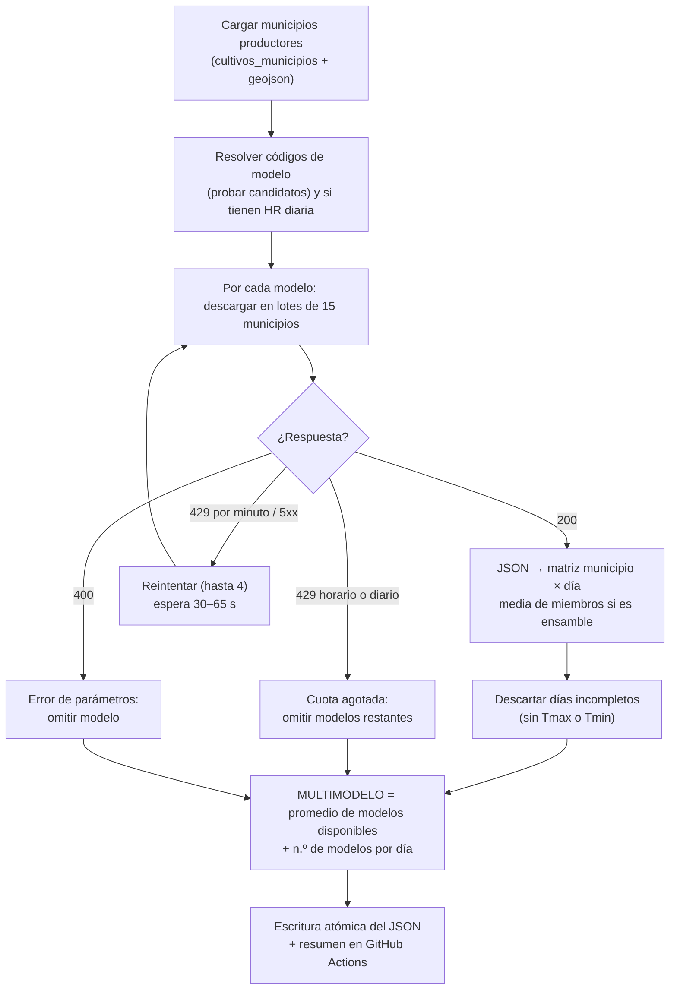

| Parámetro (`CONFIG`) | Valor | Motivo |
|---|---|---|
| `dias_pronostico` | 16 | Horizonte máximo de Open-Meteo |
| `timezone` | `America/La_Paz` | Días en hora local (UTC−4) |
| `tam_lote` | 15 municipios | Peticiones múltiples por llamada |
| `max_peso_por_minuto` / `_por_hora` | 450 / 4 000 | Margen bajo los límites gratuitos (600/min, 5 000/h, 10 000/día), porque la IP de GitHub Actions es compartida |
| `intentos_por_lote` | 4 | Reintentos con espera creciente |
| `decimales` | 1 | Tamaño del JSON |

- **Limitador de cuota:** ventanas deslizantes de 60 s y 3 600 s sobre el **peso** de cada llamada, con la fórmula de Open-Meteo: `ubicaciones × max(1, variables × miembros / 10) × max(1, días / 14)`. Con API key comercial no se aplica.
- **Variables de entorno:** `OPEN_METEO_API_KEY` (opcional; activa endpoints `customer-` y ensambles) y `USAR_ENSAMBLES` (`1`/`0` para forzar).
- **Seguridad:** la API key se enmascara en todos los mensajes de error.

```bash
pip install -r Scripts/pronostico/requirements.txt
python Scripts/pronostico/pronostico_municipios.py                         # todos
python Scripts/pronostico/pronostico_municipios.py --limite-municipios 20  # prueba rápida
```

### 7.5 Modelos agroclimáticos en Python

Carpeta: [`Scripts/Modelos_Agroclimaticos_Python/`](Scripts/Modelos_Agroclimaticos_Python/) · Requiere solo `numpy` y `pandas`. Cada script es **autocontenido** (se puede descargar y correr solo) y sigue la estructura del de R:

| Sección | Contenido |
|---|---|
| Encabezado | Plaga, fila del Excel, fórmula, umbral, diferencias con R |
| 1. Parámetros | `ID_MODELO`, `CLAVE_CULTIVO`, `PERIODO_DIAS`, `VENTANA_DIAS`, umbrales de día seco/lluvia, rutas |
| 2. Fórmula | `UMBRAL_TEXTO`, `CONDICIONES` (descripción y peso), `calcular_indice_<cultivo>()` → `(índice, condiciones)` |
| 3. Funciones comunes | `calcular_racha_seca()`, `variables_del_periodo()`, `clasificar_alerta()`, `calcular_alertas(pronostico, cultivos)`, `a_tabla()` |
| 4. Ejecución | `main()`: lee el JSON, calcula, imprime resumen por modelo y guarda un CSV |

```bash
# Un indicador (CSV en Salidas_Modelos_Agroclimaticos/Pronostico/)
python Scripts/Modelos_Agroclimaticos_Python/Papa/Script_Indice_Riesgo_Papa_Pronostico.py \
       --pronostico data/pronostico/pronostico_latest.json \
       --cultivos   data/geo/cultivos_municipios.json \
       --salida     resultados/

# Los 15 indicadores → data/alertas/alertas_latest.json
python Scripts/Modelos_Agroclimaticos_Python/correr_modelos.py
```

**`correr_modelos.py`** descubre automáticamente todos los `*/Script_Indice_Riesgo_*_Pronostico.py`, ejecuta `calcular_alertas()` de cada uno, captura errores por indicador (uno que falla no detiene a los demás), redondea (índice a 3 decimales, variables a 1) y escribe el JSON de forma atómica. **Para agregar un indicador basta con agregar su script en una carpeta nueva.**

Columnas del CSV individual: `GID_3, municipio, modelo, ventana_inicio, ventana_fin, <variables>, <condiciones>, indice, alerta`.

### 7.6 Notebook de visualización (Google Colab)

[Abrir en Colab](https://colab.research.google.com/drive/1EqN6D52Pk29cWuuGyU7cIpE8aNnrYDyq) · Explora las variables históricas procesadas (precipitación, temperaturas, HR, ETo): lectura de los GeoTIFF desde Google Drive, agregación zonal por departamento/municipio, anomalías, series temporales, mapas de calor y mapas estáticos. Librerías: `xarray`, `rasterio`, `geopandas`, `matplotlib`, `pandas`.

### 7.7 Interfaz web (JavaScript)

| Archivo | Responsabilidad |
|---|---|
| `index.html` | Estructura de todas las secciones, estilos base, carrusel del banner (con datos vivos de la corrida), metodología interactiva, selector de proyectos de scripts, explorador histórico |
| `pronostico_explorer.js` | Selector de las tres herramientas del explorador (pestañas accesibles con teclado); mapa Leaflet del pronóstico por día; escalas de color fijas por variable; tira de 16 días con reproducción automática y puntos de modelos disponibles; serie del municipio en todos los modelos (Chart.js); descarga CSV; aviso de pronóstico desactualizado |
| `alertas_explorer.js` | Selectores de cultivo, plaga y modelo; tarjetas de resumen por nivel (municipios y % de superficie); mapa semáforo; fórmula del indicador; ranking de municipios con mayor riesgo; detalle de condiciones y alerta según cada modelo; descarga CSV |
| `pronostico_explorer.css`, `alertas_explorer.css` | Estilos de los exploradores, reutilizando los tokens de color de la página |
| `explorer_data.js` | Índice `cultivo → plaga → año → periodo → ruta PNG` para la herramienta Riesgo histórico |

### 7.8 Utilitarios

| Archivo | Uso |
|---|---|
| `read_excel.ps1`, `excel_dump*.txt` | Extracción del plan de trabajo (Excel) a texto |
| `Work Plan Componente B5.xlsx` | Plan de trabajo con actividades y entregables por mes |

---

## 8. Integración de los scripts

Cómo se encadenan los scripts y los archivos que intercambian:

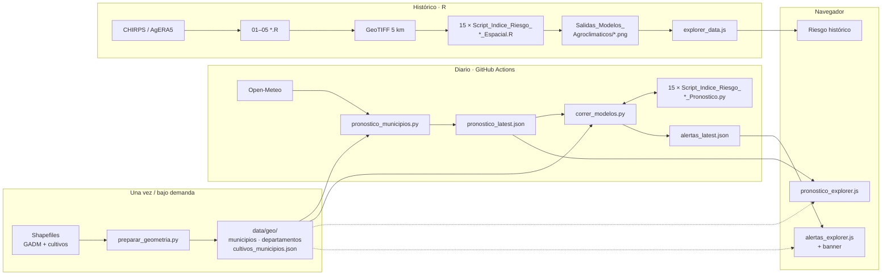

**Contratos entre componentes:**

- El identificador común es el **`GID_3`** de GADM: une shapefiles del censo, geometría web, pronóstico y alertas.
- `pronostico_municipios.py` consulta exactamente los municipios que aparecen en `cultivos_municipios.json` (305 únicos).
- Los modelos en Python leen el pronóstico por **nombre de variable de Open-Meteo** y por **modelo**, así que agregar modelos o ensambles no requiere tocarlos.
- La web solo depende de los tres JSON y del GeoJSON; los colores del semáforo vienen del propio `alertas_latest.json` (`categorias`).

---

## 9. Automatización diaria (GitHub Actions)

Workflow: [`.github/workflows/pronostico_diario.yml`](.github/workflows/pronostico_diario.yml) — **"Pronóstico diario 16 días + alertas agroclimáticas"**.

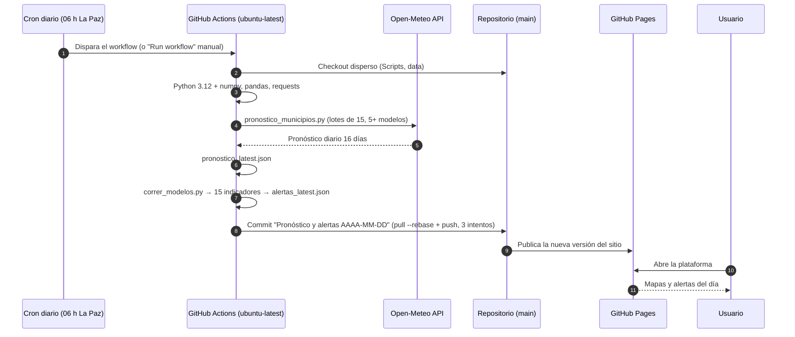

| Elemento | Configuración |
|---|---|
| Disparadores | `schedule: "0 10 * * *"` y `workflow_dispatch` (con entrada opcional `limite_municipios` para pruebas) |
| Permisos | `contents: write` (para el commit de los JSON) |
| Concurrencia | Grupo `pronostico-diario`, sin cancelar corridas en curso |
| Guarda | Solo corre en `cbarriosperez/Project_Pests_Diseases_Bolivian_Crops` (no en forks) |
| Tiempo máximo | 120 min (una corrida típica con el plan gratuito tarda ~5 min) |
| Checkout | Disperso: `Scripts/pronostico`, `Scripts/Modelos_Agroclimaticos_Python`, `data/geo`, `data/pronostico`, `data/alertas` |
| Secret opcional | `OPEN_METEO_API_KEY` (Settings → Secrets and variables → Actions) |
| Commit | `data/pronostico/pronostico_latest.json` y `data/alertas/alertas_latest.json`; si no cambiaron, no hay commit |
| Resumen | Tabla por modelo (código, días con dato, tiempo, estado) en el *summary* de la corrida |

**Manejo de fallos:**

| Situación | Comportamiento |
|---|---|
| Un modelo climático no responde | Se omite; los demás y el multimodelo siguen |
| Cuota horaria o diaria agotada | Se omiten los modelos restantes; se publica lo descargado |
| Todos los modelos fallan | El script termina con error, no hay commit y queda publicada la versión anterior |
| Un indicador agroclimático falla | Se registra en `errores` del JSON; los demás se publican |
| Conflicto al hacer push | `pull --rebase` y reintento (3 veces) |
| Pronóstico desactualizado ≥ 2 días | La web muestra un aviso en ambos exploradores |

---

## 10. Plataforma web

### 10.1 Secciones

| Sección | Contenido |
|---|---|
| **Banner** | Carrusel de 4 diapositivas: pronóstico del clima y alertas (con fecha de actualización y número de municipios en alerta alta, leídos de `alertas_latest.json`), presentación del SAT y socios |
| **Presentación** | Objetivo, fases del proyecto, tarjetas interactivas de los 15 cultivos (importancia y amenaza), infografía descargable y video introductorio |
| **Explorar Datos** | Las tres herramientas (sección 2), destacada en el menú |
| **Metodología** | Las 5 actividades en un panel interactivo, con objetivo, proceso y entregables |
| **Reportes** | Reportes técnicos en PDF descargables |
| **Scripts** | Cuatro proyectos con descripción, requisitos y descargas: series históricas (R), notebook de visualización (Colab), modelos en R y modelos en Python |

### 10.2 Ejemplo de salida

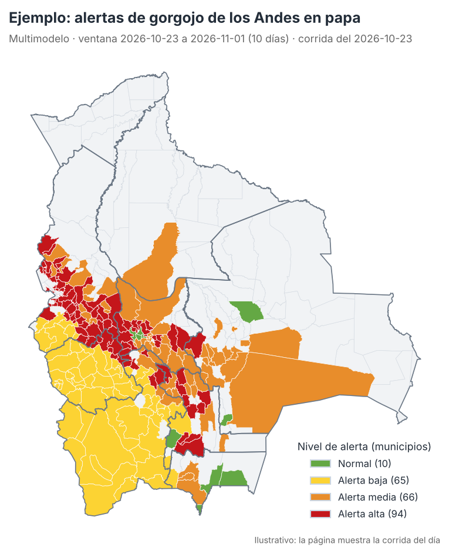

### 10.3 Ejecutar la web localmente

El sitio carga JSON con `fetch`, así que necesita un servidor (no funciona abriendo el archivo directamente):

```bash
python -m http.server 8000
# abrir http://localhost:8000
```

---

## 11. Guía de uso y mantenimiento

| Tarea | Cómo |
|---|---|
| Correr el pronóstico y las alertas fuera de horario | GitHub → **Actions** → "Pronóstico diario 16 días + alertas agroclimáticas" → **Run workflow** |
| Probar rápido el flujo | Run workflow con `limite_municipios = 20` |
| Activar ensambles (GEFS, ECMWF-ENS, AIFS-ENS, GEPS) | Agregar el secret `OPEN_METEO_API_KEY` con una clave del plan comercial de Open-Meteo |
| Consultar pronósticos o alertas de días anteriores | Historial de commits de `data/pronostico/pronostico_latest.json` o `data/alertas/alertas_latest.json` |
| Cambiar un umbral o peso | Editar `calcular_indice_*()` y `CONDICIONES` del script Python (y su par en R para mantener la coherencia) |
| Agregar un indicador | Crear `Scripts/Modelos_Agroclimaticos_Python/<Cultivo>/Script_Indice_Riesgo_<X>_Pronostico.py` siguiendo la estructura de los demás; `correr_modelos.py` y la web lo detectan solos |
| Agregar un cultivo nuevo | Agregar su shapefile en `data/geo/shapefiles/Shapefiles_cultivos/`, incluirlo en `CULTIVOS` de `preparar_geometria.py`, regenerar la geometría y crear su script de indicador |
| Actualizar la lista de municipios productores | Reemplazar los shapefiles y correr `preparar_geometria.py` |
| Agregar mapas históricos | Correr el script R, copiar los PNG a `Salidas_Modelos_Agroclimaticos/` y actualizar `explorer_data.js`; el periodo de la tarjeta se actualiza solo |

---

## 12. Limitaciones y consideraciones

- **Pronóstico puntual:** cada municipio se representa con un punto dentro de su polígono, no con el promedio de toda su superficie. En municipios grandes o de relieve complejo (Andes, Yungas), el punto puede no representar todas las zonas productoras.
- **Resolución de los modelos globales:** del orden de 10 a 25 km; no resuelven microclimas de valles estrechos.
- **Incertidumbre creciente con el plazo:** la habilidad de los pronósticos disminuye después de la primera semana. Los indicadores con ventanas de 14–15 días dependen de pocos modelos al final (con el plan gratuito, solo GFS en los días 15–16).
- **Ventana desde hoy:** las alertas describen condiciones futuras; no incorporan la lluvia o temperatura de los días previos (relevante para la racha seca).
- **Umbrales:** provienen de la literatura y de la consulta a expertos (catálogo de plagas y enfermedades). Una alerta indica **condiciones climáticas favorables**, no la presencia confirmada de la plaga; su calibración con registros de incidencia en campo es una línea de trabajo futura.
- **Café:** la adaptación a 14 días (umbral escalado) es una aproximación al indicador original de 30 días.
- **Cuotas de Open-Meteo:** el plan gratuito limita el número de modelos (sin ensambles para 305 municipios) y es de uso no comercial.

---

## 13. Solución de problemas

| Síntoma | Causa probable | Solución |
|---|---|---|
| La pestaña de alertas dice "No se pudieron cargar las alertas … 404" | `alertas_latest.json` aún no existe | Correr el workflow manualmente |
| Aviso "no se ha actualizado en N días" | El workflow no corrió o falló | Revisar Actions. GitHub desactiva los workflows programados si el repositorio pasa 60 días sin actividad; se reactivan desde la pestaña Actions |
| Un modelo aparece como "no cubre la ventana" | Su horizonte es menor que la ventana del indicador | Comportamiento esperado (sección 6.4) |
| El *summary* muestra modelos con ❌ | Caída temporal o cambio de código en Open-Meteo | Se resuelve sola en la siguiente corrida; si persiste, revisar `candidatos` en `MODELOS_DETERMINISTAS` |
| Error 429 "Daily/Hourly API request limit exceeded" | Cuota gratuita agotada (IP compartida de GitHub) | Reintentar más tarde o usar `OPEN_METEO_API_KEY` |
| El push del workflow falla | Commits simultáneos en `main` | El workflow reintenta 3 veces; si falla, volver a correrlo |
| La web no muestra cambios | Caché del navegador o Pages en publicación | Esperar 1–2 min y recargar con Ctrl + F5 |
| Avisos "Node.js 20 is deprecated" | Versiones de las acciones | Subir `actions/checkout` a `@v5` y `actions/setup-python` a `@v6` |

---

## 14. Reportes y productos

| Reporte | Fecha | Contenido |
|---|---|---|
| [Reporte 1: Distribución espacial de cultivos priorizados](Reportes/CIAT_Reporte%201_Distribución%20Espacial_Cultivos%20Priorizados.pdf) | Abril 2026 | Línea base: distribución geográfica de los cultivos y zonas de mayor importancia agrícola |
| [Reporte 2: Metodología y cronograma del SAT](Reportes/CIAT_Reporte%202_Informe%20Metodológico%20y%20Cronograma%20del%20Sistema%20de%20Alerta%20Temprana.pdf) | Mayo 2026 | Marco metodológico, componentes y cronograma |
| [Reporte 3: Generación de series climáticas históricas](Reportes/CIAT_Reporte%203_Generación%20de%20series%20climática%20históricas_Bolivia.pdf) | Julio 2026 | Procesamiento y armonización de CHIRPS y AgERA5 |

**Productos de software:** series climáticas a 5 km (1981–2025), 15 modelos en R, 15 modelos en Python, motor de pronóstico y alertas automatizado, plataforma web pública.

---

## 15. Hoja de ruta

- [ ] Corregir el cálculo de la racha seca en los cuatro scripts R afectados y regenerar sus mapas históricos.
- [ ] Incorporar los días observados previos (p. ej. `past_days` de Open-Meteo) para que la racha seca no empiece en cero.
- [ ] Activar los modelos de ensamble con una API key y mostrar la probabilidad de alerta (fracción de miembros).
- [ ] Pronósticos estacionales (CCA + remuestreo histórico a escala diaria), contemplados en el plan de trabajo.
- [ ] Validación de las alertas con registros de incidencia en campo.
- [ ] Modelo para Maíz berza.
- [ ] Actualizar `actions/checkout` y `actions/setup-python` a versiones con Node.js 24.

---

## 16. Fuentes, licencias y créditos

| Fuente | Uso | Referencia / condiciones |
|---|---|---|
| CHIRPS v3 | Precipitación histórica | Climate Hazards Center, UC Santa Barbara. Funk et al. (2015), *Scientific Data* 2, 150066 |
| AgERA5 v2 | Temperatura, HR, ETo, VPD | Copernicus Climate Change Service (C3S). Boogaard et al. (2020), C3S Climate Data Store. Licencia Copernicus |
| Open-Meteo | Pronóstico diario | [open-meteo.com](https://open-meteo.com/), datos CC BY 4.0; plan gratuito para uso no comercial |
| GADM 4.1 | Límites municipales | [gadm.org](https://gadm.org/); uso académico y no comercial |
| Censo agropecuario | Superficie y producción por municipio | Shapefiles por cultivo del proyecto |
| Leaflet, Chart.js | Interfaz web | Licencias BSD-2 y MIT |

**Créditos:** desarrollado por el **Agroclimatic Modeling Team** de la Alliance of Bioversity International & CIAT, en conjunto con YAPU Solutions, para BDP. Desarrollo y mantenimiento: **[Camilo Barrios-Pérez](https://github.com/cbarriosperez)** (c.barrios@cgiar.org).

**Cómo citar:**
> Barrios-Pérez, C. (2026). *Sistema de Alerta Temprana para Plagas y Enfermedades en Cultivos Bolivianos* [Plataforma y código]. Alliance of Bioversity International & CIAT. https://github.com/cbarriosperez/Project_Pests_Diseases_Bolivian_Crops

Si esta plataforma te ha sido útil, ¡dale una ⭐ al repositorio!
